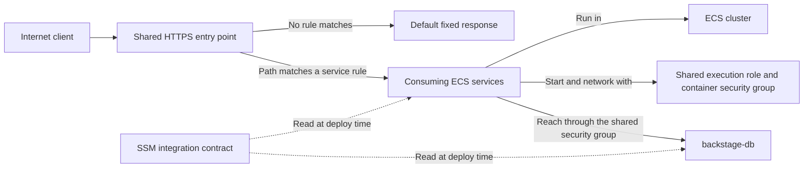
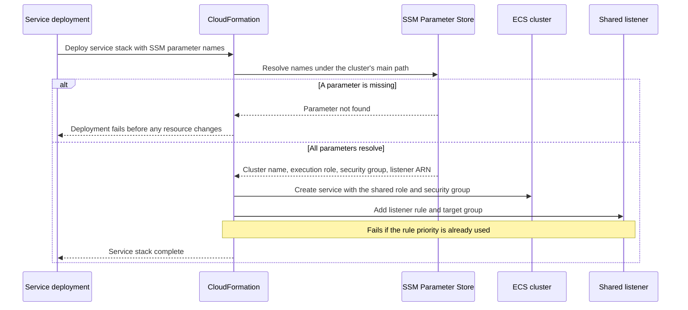
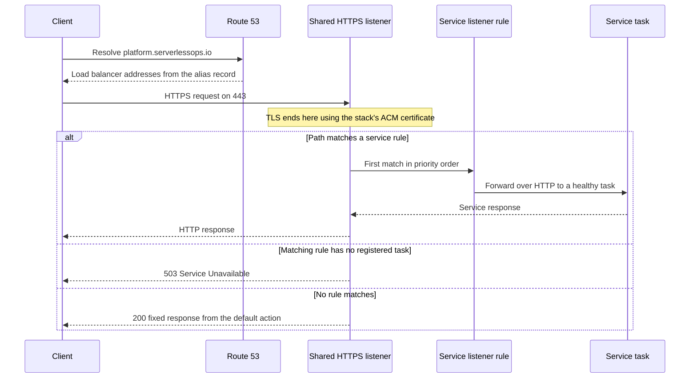
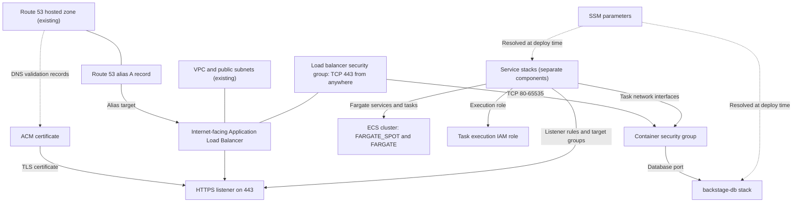
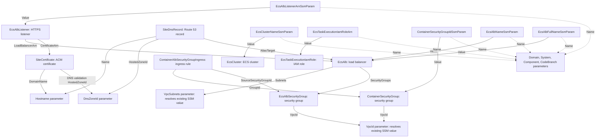

# Architecture

## Infrastructure

### Logical architecture

The cluster is shared infrastructure for the services of the `backstage`
system. It provides workload placement, a public entry point, and the identity
and network access that tasks share, and publishes what service stacks need to
attach to each:

- The ECS cluster is the placement boundary. It owns no compute capacity;
  services run their tasks on Fargate or Fargate Spot.
- The shared load balancer is the single public HTTPS entry point. It
  terminates TLS for one hostname; each service attaches a path-based rule.
- The shared task execution role lets ECS pull images and write logs for any
  task in the cluster.
- The shared container security group admits traffic from the load balancer
  and identifies cluster tasks to other stacks, such as the database.
- The SSM integration contract publishes the generated identifiers, so
  consuming stacks resolve them at deploy time and never hard-code names or
  ARNs.

Services, their tasks, images, task roles, target groups, and logs belong to
the consuming service components, not to this cluster.

#### Logical architecture diagram



#### Service attachment call sequence

A service stack attaches to the cluster when it deploys. Nothing in the
cluster stack changes; the service only reads the published values.



Parameters are resolved when a consuming stack deploys, not continuously. A
changed value reaches a consumer only on that consumer's next deployment.

#### Request routing call sequence

The listener evaluates the rules added by services in ascending priority order
and falls back to the cluster's default action.



The fixed response is the listener's default action. It does not indicate that
any service is running or healthy. Traffic between the load balancer and tasks
is unencrypted HTTP inside the VPC.

While `backstage-app` holds a `*` rule, every request matches it and the
default action is never reached.

### Physical architecture



`template.yaml` owns the cluster, execution role, both security groups, load
balancer, listener, certificate, DNS record, and SSM parameters. The VPC,
subnets, hosted zone, `/org/networking/...` SSM parameters, and CI roles are
external dependencies. Listener rules, target groups, services, tasks, and task
roles are owned by the service stacks. The database's own security group and
its rule admitting the container security group are owned by `backstage-db`.

The SSM parameter names are listed in
[Features](01-features.md#ssm-integration-contract).

### CloudFormation template

`template.yaml` is the infrastructure-as-code entry point. Its
`Transform: AWS::Serverless-2016-10-31` lets the SAM CLI validate, build, and
deploy it, but it declares no SAM resource types: every resource is a standard
CloudFormation type. The template has no `Conditions` or `Outputs`; other
stacks consume it only through SSM parameters.

| Section | Purpose |
| --- | --- |
| `Parameters` | Supplies domain/system/component metadata, the deployed ref, the hostname, the hosted zone ID, and SSM parameter names for the VPC and subnets. |
| `Resources` | Declares the cluster, execution role, two security groups and the rule between them, load balancer, listener, certificate, DNS record, and six SSM parameters. |

`Ref` and `GetAtt` connect resources without hard-coding generated names or
ARNs, and the SSM parameter names are built from the metadata parameters with
`Sub`.

#### Template resource relationships

Arrows below run from the referencing resource/configuration to its target;
they show infrastructure references, not request flow.



Replacing the cluster, execution role, container security group, load
balancer, or listener changes the value of the matching SSM parameter.
Consumers keep using the old value until they redeploy, and a replaced listener
loses every service's rule. CloudFormation cannot delete the old container
security group while tasks or the database's ingress rule still use it.

Two details of the SSM resources are easy to misread:

- The logical ID `EcsTaskExecutionIamRoleArn` names an SSM parameter, not the
  role, and its value is the role name. See
  [Features](01-features.md#ssm-integration-contract).
- The `Description` properties of `ContainerSecurityGroupIdSsmParam` and
  `EcsAlbNameSsmParam` were copied from neighboring resources and do not
  describe their values. Go by the parameter name.

`cfn-parameters.json` and `cfn-tags.json` provide deployment-action inputs,
while `samconfig.toml` supplies SAM deployment defaults. See
[Configuration](03-configuration.md) for their expression syntax and external
prerequisites. Validate changes with `sam validate --lint` before deployment.

## Software

### Repository file layout

```text
catalog-info.yaml       Backstage Component entity
docs/handbook/          Handbook pages
README.md               Project entry point
template.yaml           SAM/CloudFormation cluster infrastructure
cfn-parameters.json     Deployment-action parameter expressions
cfn-tags.json           Deployment-action tag expressions
samconfig.toml          SAM validate and deploy defaults
.github/workflows/      main.yml, techdocs-docs.yml, techdocs-specs.yml
```

The repository contains no application code, container image, or tests. The
software that runs in the cluster lives in the service components that depend
on it. `backstage-app` declares the dependency in its `catalog-info.yaml`, so
it appears under this component's dependents in the catalog. `backstage-db`
consumes the container security group through SSM.
